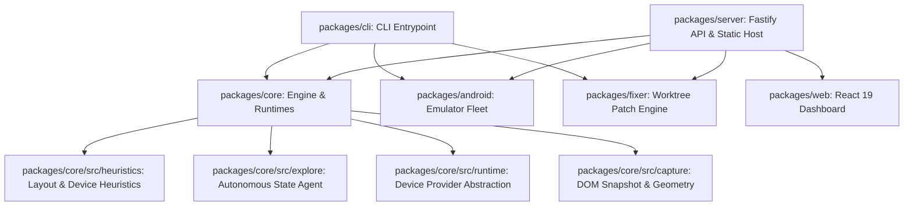

# PixelSentinel Platform Documentation

> **Intelligent Visual QA, Multi-Device Testing, Autonomous Exploration & Self-Verifying Fix Proposals**

PixelSentinel is a next-generation visual testing and QA platform for modern web applications. It transcends traditional static screenshot diffing by combining headless browser runtimes, real Android emulator fleet orchestration, layout-geometry heuristics, multimodal LLM vision auditing, autonomous multi-state UI exploration, and sandboxed self-verifying fix proposals.

---

## 1. System Architecture & Monorepo Topology

PixelSentinel is structured as a TypeScript monorepo managed with `pnpm` workspaces:



### Workspace Packages

| Package | Path | Responsibility |
| :--- | :--- | :--- |
| **`@pixelsentinel/core`** | [`packages/core`](file:///home/mevlec/Data/devinv2/packages/core) | Core scanning engine, DOM snapshotting, layout heuristics, device runtimes, exploration agent, and reporting. |
| **`@pixelsentinel/android`** | [`packages/android`](file:///home/mevlec/Data/devinv2/packages/android) | Android emulator fleet orchestration, KVM/JDK diagnostics (`doctor`), ADB bridge, and warm-pool lifecycle. |
| **`@pixelsentinel/fixer`** | [`packages/fixer`](file:///home/mevlec/Data/devinv2/packages/fixer) | Sourcemap resolution, LLM unified diff generation, and isolated throwaway Git worktree verification. |
| **`@pixelsentinel/cli`** | [`packages/cli`](file:///home/mevlec/Data/devinv2/packages/cli) | Terminal commands (`scan`, `devices doctor`, `devices list`, `fixes list/show/apply`). |
| **`@pixelsentinel/server`** | [`packages/server`](file:///home/mevlec/Data/devinv2/packages/server) | Fastify backend providing REST APIs and static serving of the React UI and generated artifacts. |
| **`@pixelsentinel/web`** | [`packages/web`](file:///home/mevlec/Data/devinv2/packages/web) | React 19 + Vite dashboard featuring Device × State matrices, proposed diff viewer, and scan controllers. |

---

## 2. Phase 1 — Core Responsive Visual Defect Scanner

Phase 1 established the baseline scanning engine, spatial geometry heuristics, AI visual auditing, and interactive reporting.

### A. Viewport Matrix & Headless Capture
- Executes headless Chromium via Playwright across customizable responsive matrices (Desktop 1080p, 1440p, Laptop, Ultrawide, iPhone 14, Pixel 7, iPad Pro, iPhone SE).
- Traverses the entire DOM tree in-browser ([`dom-snapshot.ts`](file:///home/mevlec/Data/devinv2/packages/core/src/capture/dom-snapshot.ts)) to extract computed styles, layout geometry (`getBoundingClientRect`), scroll dimensions, and text content.

### B. Algorithmic Layout Heuristics
- **Horizontal Overflow** ([`horizontal-overflow.ts`](file:///home/mevlec/Data/devinv2/packages/core/src/heuristics/horizontal-overflow.ts)): Detects content protruding beyond viewport boundaries causing unwanted horizontal scrollbars.
- **Element Overlap** ([`element-overlap.ts`](file:///home/mevlec/Data/devinv2/packages/core/src/heuristics/element-overlap.ts)): Computes 2D axis-aligned bounding box (AABB) intersections between sibling elements to catch unintentional collisions while respecting semantic layering (z-index, modals, icons, form controls).
- **Text & Content Clipping** ([`clipped-text.ts`](file:///home/mevlec/Data/devinv2/packages/core/src/heuristics/clipped-text.ts)): Identifies truncated text and clipped elements where `scrollWidth > clientWidth` or `scrollHeight > clientHeight` under `overflow: hidden`.

### C. Multimodal AI Vision Auditing
- Leverages OpenAI (`gpt-4o`) with structured JSON schemas ([`openai-vision.ts`](file:///home/mevlec/Data/devinv2/packages/core/src/heuristics/openai-vision.ts)) to evaluate rendered viewport screenshots.
- Correlates visual layout flaws with underlying DOM elements, assigning confidence scores and CSS repair recommendations.

### D. Interactive HTML Report & Dashboard
- Generates a standalone, dependency-free HTML report ([`html-report.ts`](file:///home/mevlec/Data/devinv2/packages/core/src/report/html-report.ts)) with clickable bounding-box overlays, selector copy buttons, and severity filters.
- Provides a real-time web dashboard ([`App.tsx`](file:///home/mevlec/Data/devinv2/packages/web/src/App.tsx)) connected to the Fastify server.

---

## 3. Phase 2 — Real-Device Runtimes, Autonomous Exploration & Fix Proposals

Phase 2 expanded PixelSentinel into an intelligent multi-device platform with physical device capabilities, autonomous exploration, and safe patch verification.

### A. Device Runtime Provider Abstraction ([`packages/core/src/runtime/`](file:///home/mevlec/Data/devinv2/packages/core/src/runtime))
Standardized provider interface [`DeviceRuntime`](file:///home/mevlec/Data/devinv2/packages/core/src/runtime/types.ts) with dynamic registry [`DeviceRegistry`](file:///home/mevlec/Data/devinv2/packages/core/src/runtime/registry.ts):
- **`PlaywrightRuntime`**: Desktop Chromium and true WebKit 27.2 iOS engine approximation.
- **`AndroidRuntime`**: Physical Android devices & emulators connected via ADB, forwarding Chrome DevTools Protocol over Unix domain sockets.
- **`WindowsRuntime`**: Remote Windows CDP integration simulating ClearType font rendering, Segoe UI metrics, and fractional DPI scaling.

### B. Hardware & Form-Factor Layout Heuristics ([`packages/core/src/heuristics/device/`](file:///home/mevlec/Data/devinv2/packages/core/src/heuristics/device))
- **Safe Area & Notch Intrusion** ([`safe-area.ts`](file:///home/mevlec/Data/devinv2/packages/core/src/heuristics/device/safe-area.ts)): Audits element collisions against hardware cutouts, notches, dynamic islands, and OS gesture navigation bars.
- **Soft Keyboard Obstruction** ([`keyboard.ts`](file:///home/mevlec/Data/devinv2/packages/core/src/heuristics/device/keyboard.ts)): Simulates virtual keyboard presentation (~40% viewport height) and verifies whether focused inputs or action buttons are obscured. Traverses parent container hierarchies for fixed/sticky positioning.
- **Foldable Hinge Collision** ([`hinge.ts`](file:///home/mevlec/Data/devinv2/packages/core/src/heuristics/device/hinge.ts)): Detects elements split or bisected by physical foldable hinge seams.
- **TV Overscan Margins** ([`overscan.ts`](file:///home/mevlec/Data/devinv2/packages/core/src/heuristics/device/overscan.ts)): Checks Smart TV applications against SMPTE 5% safety boundaries.
- **Spatial Focus Rings** ([`focus-ring.ts`](file:///home/mevlec/Data/devinv2/packages/core/src/heuristics/device/focus-ring.ts)): Ensures interactive controls on TV D-pad navigation display visible, high-contrast focus rings.

### C. Android Fleet Orchestration ([`packages/android/`](file:///home/mevlec/Data/devinv2/packages/android))
- **`doctor.ts`**: Audits host prerequisites: KVM virtualization (`/dev/kvm`), OpenJDK 17+, Android SDK, ADB, and available RAM (>= 8GB requirement for pooling).
- **`profiles.ts`**: Preconfigured hardware profiles (Pixel 8, Pixel Fold, TV 1080p) with hardware cutouts and density ratios.
- **`adb.ts`**: Handles device listing, port forwarding, screencaps, and key event injection.
- **`emulator-pool.ts`**: Manages warm-pool lifecycle of headless Android emulators (`-no-window -gpu swiftshader_indirect`).

### D. Autonomous Multi-State Exploration Engine ([`packages/core/src/explore/`](file:///home/mevlec/Data/devinv2/packages/core/src/explore))
- **Structural DOM Fingerprinting** ([`fingerprint.ts`](file:///home/mevlec/Data/devinv2/packages/core/src/explore/fingerprint.ts)): Computes structural hashes of the DOM topology to identify new UI states (modals, menus, forms, error states) regardless of timestamps or dynamic text.
- **LLM Vision Agent** ([`agent.ts`](file:///home/mevlec/Data/devinv2/packages/core/src/explore/agent.ts)): OpenAI vision-guided agent with interactive tool calling (`tap`, `fill_form`, `scroll`, `finish_exploration`).
- **Pilot-then-Replay Scheduler** ([`scheduler.ts`](file:///home/mevlec/Data/devinv2/packages/core/src/explore/scheduler.ts)): Conducts exploratory pilot runs on a baseline device, records the action trace (`trace.json`), and deterministically replays the steps across all other device runtimes to construct the complete Device × State matrix.

### E. Self-Verifying Fix Proposals ([`packages/fixer/`](file:///home/mevlec/Data/devinv2/packages/fixer))
- **Source Mapping** ([`sourcemap.ts`](file:///home/mevlec/Data/devinv2/packages/fixer/src/sourcemap.ts)): Traces defect DOM selectors back to source files (HTML, CSS, React components).
- **Patch Generator** ([`generator.ts`](file:///home/mevlec/Data/devinv2/packages/fixer/src/generator.ts)): Formulates unified diffs (`diff --git a/... b/...`) with contextual CSS repairs.
- **Isolated Worktree Sandboxing** ([`worktree.ts`](file:///home/mevlec/Data/devinv2/packages/fixer/src/worktree.ts)): Spawns isolated throwaway Git worktrees under `.pixelsentinel/worktrees/`, applies patches with `git apply --check`, and validates fixes without modifying the user's active working directory.
- **Proposal Verifier** ([`verifier.ts`](file:///home/mevlec/Data/devinv2/packages/fixer/src/verifier.ts)): Tags proposals as `VERIFIED` or `FAILED`, presenting verification status directly in CLI and web dashboards.

---

## 4. Startup Script & Execution Modes

PixelSentinel provides a unified startup script [run.sh](file:///home/mevlec/Data/devinv2/run.sh) located in the repository root:

```bash
# Make executable (already set)
chmod +x run.sh

# Start production dashboard at http://localhost:3000
./run.sh

# Start on a custom port
./run.sh --port 8080

# Start in development mode with hot-reloading (Fastify backend + Vite web client)
./run.sh --dev

# Force rebuild workspace packages before launching
./run.sh --build

# View available options
./run.sh --help
```

---

## 5. CLI Command Reference

All commands are accessible via `node packages/cli/dist/bin.js` or `pnpm pixelsentinel`:

```bash
# 1. Run standard multi-viewport visual scan
node packages/cli/dist/bin.js scan http://localhost:5173

# 2. Run scan against local directory with auto-static server
node packages/cli/dist/bin.js scan fixtures/baseline

# 3. Autonomous exploration scan with AI fix proposals
node packages/cli/dist/bin.js scan fixtures/flows --explore --max-steps 8 --propose-fixes --out pixelsentinel-output/flows-explore

# 4. Audit Android host readiness
node packages/cli/dist/bin.js devices doctor

# 5. List registered real & approximate devices
node packages/cli/dist/bin.js devices list

# 6. List generated fix proposals and verification status
node packages/cli/dist/bin.js fixes list --out pixelsentinel-output/flows-explore

# 7. Show unified diff for a specific fix proposal
node packages/cli/dist/bin.js fixes show <patch-id> --out pixelsentinel-output/flows-explore

# 8. Apply a verified fix patch to working tree
node packages/cli/dist/bin.js fixes apply <patch-id> --out pixelsentinel-output/flows-explore
```

---

## 6. Server REST API Reference

The Fastify backend ([`packages/server/src/index.ts`](file:///home/mevlec/Data/devinv2/packages/server/src/index.ts)) exposes the following endpoints:

| Endpoint | Method | Description |
| :--- | :---: | :--- |
| **`/api/scan`** | `POST` | Dispatches an asynchronous scan job. Accepts `target`, `explore`, `maxSteps`, `devices`. |
| **`/api/jobs/:id`** | `GET` | Retrieves scan job status, progress step, and completed report. |
| **`/api/jobs/:id/events`** | `GET` | SSE stream for real-time progress and step notifications. |
| **`/api/devices/doctor`** | `GET` | Returns Android host capability audit (KVM, Java, ADB, RAM). |
| **`/api/devices`** | `GET` | Lists registered device targets and connected ADB hardware. |
| **`/api/fixes`** | `GET` | Returns list of generated fix proposals and verification statuses. |
| **`/artifacts/*`** | `GET` | Serves scan artifacts (screenshots, HTML reports, traces). |
| **`/`** | `GET` | Serves compiled React web dashboard. |

---

## 7. Test Fixtures & Quality Verification

### Dedicated Test Fixtures

| Fixture Path | Description | Targeted Defects |
| :--- | :--- | :--- |
| [`fixtures/baseline/clean.html`](file:///home/mevlec/Data/devinv2/fixtures/baseline/clean.html) | Responsive baseline landing page | Baseline (0 defects) |
| [`fixtures/baseline/overflow-horizontal.html`](file:///home/mevlec/Data/devinv2/fixtures/baseline/overflow-horizontal.html) | Wide cards and tables breaching viewport | `horizontal-overflow` |
| [`fixtures/baseline/overlap.html`](file:///home/mevlec/Data/devinv2/fixtures/baseline/overlap.html) | Overlapping titles, buttons, and badges | `element-overlap` |
| [`fixtures/baseline/clipped.html`](file:///home/mevlec/Data/devinv2/fixtures/baseline/clipped.html) | Text and buttons cut off by container bounds | `clipped-text` |
| [`fixtures/device/safe-area.html`](file:///home/mevlec/Data/devinv2/fixtures/device/safe-area.html) | Fixed header colliding with hardware notch | `safe-area-intrusion` |
| [`fixtures/device/keyboard.html`](file:///home/mevlec/Data/devinv2/fixtures/device/keyboard.html) | Bottom chat bar covered by virtual keyboard | `keyboard-obstruction` |
| [`fixtures/device/hinge.html`](file:///home/mevlec/Data/devinv2/fixtures/device/hinge.html) | Dialog box split across foldable hinge seam | `hinge-overlap` |
| [`fixtures/device/overscan.html`](file:///home/mevlec/Data/devinv2/fixtures/device/overscan.html) | Navigation bar placed outside 5% TV margin | `overscan-margin` |
| [`fixtures/device/focus-ring.html`](file:///home/mevlec/Data/devinv2/fixtures/device/focus-ring.html) | TV buttons lacking focus rings on D-pad navigation | `missing-focus-ring` |
| [`fixtures/flows/index.html`](file:///home/mevlec/Data/devinv2/fixtures/flows/index.html) | Multi-state e-commerce app with promo modal & drawer | Multi-state exploration & fixes |

### Vitest Test Suite Results

Run the full automated test suite with:
```bash
pnpm test
```

**Results: 29 / 29 tests passing across all 8 test suites:**
- `packages/fixer/test/fixer.test.ts` (4/4 passed) — Sourcemapping, diff generation, isolated git worktree sandboxing.
- `packages/android/test/doctor.test.ts` (2/2 passed) — Host requirement parsing and doctor checks.
- `packages/core/test/config.test.ts` (5/5 passed) — Configuration validation and schema defaults.
- `packages/core/test/spatial.test.ts` (3/3 passed) — 2D spatial coordinate and AABB collision calculations.
- `packages/core/test/runtime.test.ts` (3/3 passed) — Playwright WebKit & Chromium device session lifecycle.
- `packages/core/test/explore.test.ts` (3/3 passed) — Pilot-then-replay scheduler and DOM fingerprinting.
- `packages/core/test/integration.test.ts` (4/4 passed) — End-to-end multi-viewport heuristic scans.
- `packages/core/test/device-heuristics.test.ts` (5/5 passed) — Notch, keyboard, hinge, overscan, and focus ring detectors.
